<p align="center">
  
</p>

<h3 align="center">Privacy-first • Immutable • Built on Linux • Designed for people</h3>

<p align="center"><em>A desktop operating system that makes secure computing simple, intuitive, and accessible.</em></p>

<p align="center"><strong><a href="https://thulasiramk-2310.github.io/Arka/">Website</a></strong> · <a href="https://thulasiramk-2310.github.io/Arka/#tour">One-minute tour video</a> · <a href="https://thulasiramk-2310.github.io/Arka/docs/">Docs</a></p>

<p align="center">
  
  
  
  
</p>

<p align="center">
  
</p>

---

## What is ArkaOS?

ArkaOS is a privacy-first, immutable desktop operating system built on Linux,
designed to make secure computing simple, intuitive, and accessible for everyone.

It isn't trying to replace Linux — it builds on Linux's strengths while removing
unnecessary complexity and making powerful privacy and security features
available by default.

The OS ships as a single immutable image: updates are atomic, the previous version is kept,
and the root filesystem is read-only at runtime. A system daemon —
[`arkad`](arkad/) — periodically checks configured privacy settings, retries failures, and logs
selected enforcement events. A successful check describes those settings, not
every application or network connection.

> **Built on Linux. Designed for people.**

## Developer Preview 1

| | | |
|---|---|---|
| ✅ Immutable rootfs (composefs) | ✅ Atomic image updates | ✅ Privacy daemon (arkad) |
| ✅ Privacy Dashboard + weekly report | ✅ Browser sandbox (bubblewrap) | ✅ Permission manager |
| ✅ Branded KDE Plasma shell | ✅ Capsule app store | ✅ Boot animation (Plymouth) |
| ✅ Custom login (SDDM) | ✅ Design System v1.0 | ✅ Icons · cursor · sounds · wallpaper |
| ✅ WiFi · Bluetooth · power profiles | ✅ Search · clipboard · previews | ✅ First-boot welcome wizard |

DP1 ships as a **qcow2 for QEMU/KVM**, developer audience, no installer yet —
by design. Details: [Release Notes](docs/RELEASE-NOTES-DP1.md) · [Changelog](CHANGELOG.md)

## Since DP1 — DP2 groundwork

Source work and recorded test observations toward Developer Preview 2 (see [Field Notes](docs/FIELD-NOTES.md)):

- 🖥️ **First bare-metal boot.** ArkaOS booted on real hardware for the first time —
  an Intel i5-10210U laptop, from a USB stick, internal disk untouched: GRUB → KDE
  Plasma desktop, with Wi-Fi, touchpad, display, brightness and suspend/resume all
  working, and `arka-pulse` reading a real thermal sensor. One machine so far —
  early, but the roadmap's "real hardware" line has its first proof.
- 🩺 **arka-pulse reliability engine.** A read-only *System Health* surface
  (`org.arka.pulse`, mirroring `arkad`): deterministic monitoring, honest about
  what it can't yet measure. See the [design](docs/RELIABILITY-ARKA-PULSE.md).
- 🔒 **Privacy wording under review.** Firefox tracking and fingerprinting-script
  blocking settings reduce some tracking; they do not prevent fingerprinting.
  “Configured” means the checked setting is in place, not “you are protected.”
  Missing or stale checks must remain unknown. See the [threat model](docs/THREAT-MODEL.md).
- 🐞 **Source fixes from real use:** browser audio socket access and Capsule's
  user-level Flathub setup. Playback and installation still need a rebuilt-image
  test on the Nokia; source tests are not hardware confirmation.

- 🎨 **Fedora 44 candidate: new setup and a Light/Dark look.** A rewritten first-boot
  setup (choose Light or Dark, create your account, see where each privacy setting
  stands right now, then sign in). The login screen, desktop, icons and every ArkaOS
  app follow that choice, and Settings › Appearance switches it later. The first
  desktop starts in the ArkaOS look, and the boot logo stays centred when the
  display changes resolution. Tested in a VM in both looks; not yet on hardware.
- 📊 **Privacy Dashboard without a score.** It lists each setting as *Configured*
  or not, says how long ago it was checked, and has a page for updates and
  going back to the previous version.
- ⬆️ **Updates never restart the computer on their own.** They download in the
  background; the Updates app shows the installed version, any downloaded update,
  whether a restart is needed and whether a previous version is available. You
  choose when to restart.
- 🧱 **Firewall on by default.** An ArkaOS firewall zone rejects connections
  other computers try to open to this one. arkad checks the zone's actual rules
  and policies, not just its name, and setup, the dashboard and the tray show it.
- 🌐 **Encrypted DNS with an honest exception.** On a network that blocks encrypted
  DNS (some hotels and sign-in pages), the dashboard notices that names aren't
  resolving and offers to allow unencrypted DNS **on that network only**. It then
  shows *Off on this network*, and other networks stay strict.
- 🛡️ **Kernel hardening.** Stricter kernel boot options (memory wiping,
  lockdown in integrity mode, and others) and runtime settings. User namespaces stay
  on, because Firefox's sandbox and Flatpak need them.
- 🩹 **Boot health checks (greenboot): automatic rollback does not work yet.**
  Tested on 2026-10-11 with a deliberately broken update: the health checks caught
  it on three boot attempts, but the system **did not switch back** to the
  previous version (greenboot never recorded which version to return to). Its
  boot-counter logic then kept selecting the broken entry, so its automatic parts
  are being switched off until fixed. Files in `/home` and `/var` were unchanged
  throughout.
- 🎯 **App icons:** one family, a distinct colour per app; Firefox and the file
  manager keep their own icons.
- 🐞 **Fixes from the Nokia test:** the disk image no longer enables a serial
  console (the cause of a crash loop there), and `scripts/flash-usb.sh` writes and
  verifies USB sticks and repairs the GPT. In a VM, a Capsule app install from
  Flathub completed. Neither is confirmed on the Nokia yet.

Everything above was tested in a VM on 2026-10-11 unless it says otherwise. Still a
developer preview: no installer or disk encryption yet, one hardware data point,
and known polish tracked in the field notes.

---

## Architecture

<p align="center">
  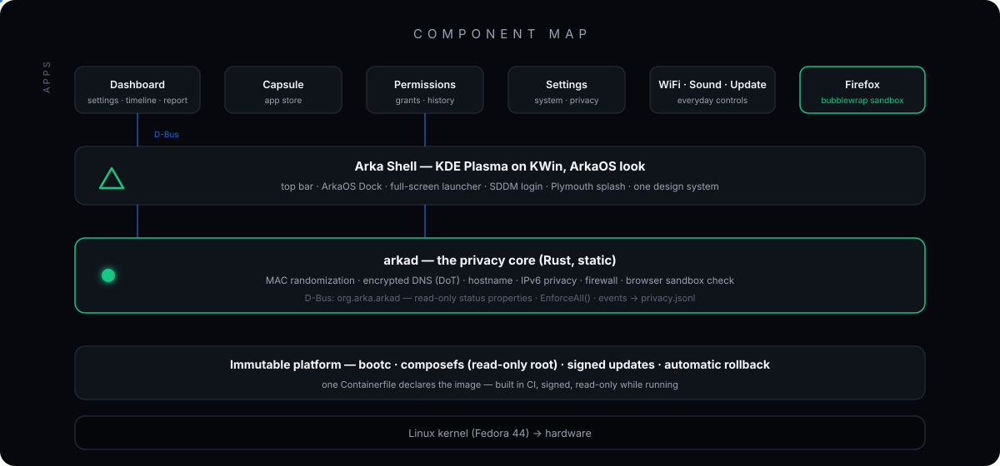
</p>

Why bootc, why Plasma, why D-Bus, why not our own compositor — the reasoning
lives in [docs/ARCHITECTURE.md](docs/ARCHITECTURE.md).

## The privacy model

<p align="center">
  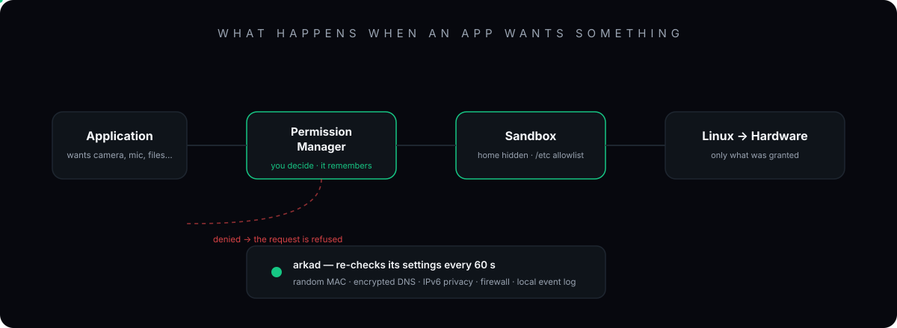
</p>

**The browser has a restricted filesystem view.** The wrapper hides the real
home except `~/Downloads`, which remains readable and writable. It exposes
allowlisted system files, Wayland and audio sockets; audio access can include
microphone recording. Session D-Bus is hidden. Earlier isolation checks are
recorded in [PHASE4-SANDBOX.md](PHASE4-SANDBOX.md); each release still needs testing.

**Periodic configuration checks:** arkad attempts MAC randomization, strict
DNS-over-TLS policy, a generic hostname, IPv6 temporary-address settings and the
ArkaOS firewall zone. A per-network DNS exception is shown as such, never as
encrypted.
Checks can fail; configured DNS policy does not prove that every app uses it.
The tray requires a completed check less than three 30-second polls old.
OS rollback selects another system deployment; it does not restore older
personal files or guarantee that the selected image will boot.

## From one image, everything

<p align="center">
  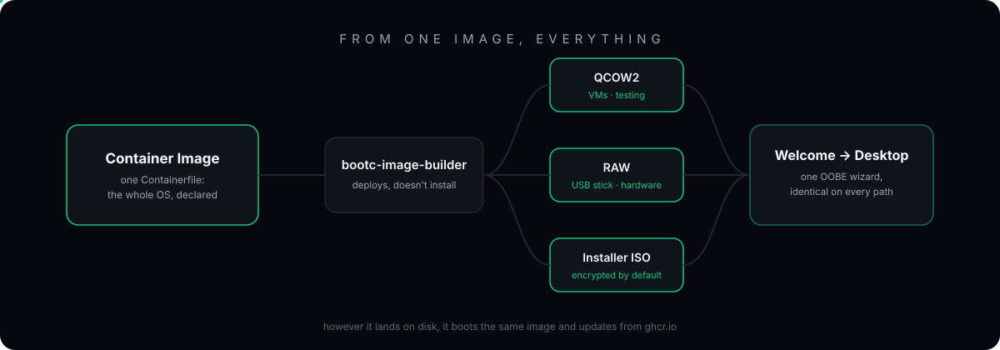
</p>

Installation is delivery, not configuration — however the bits land on disk,
the system that boots is byte-identical and greets you with the same welcome
wizard. Strategy: [docs/INSTALLATION-ARCHITECTURE.md](docs/INSTALLATION-ARCHITECTURE.md)

## How it's built

<p align="center">
  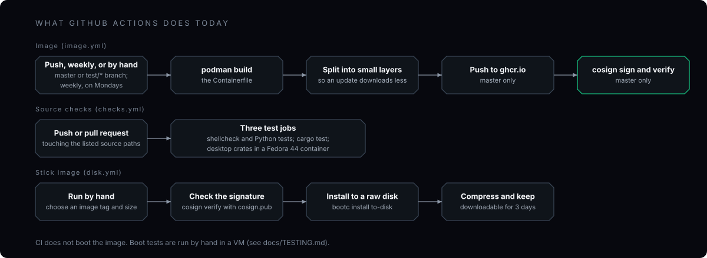
</p>

**Compile success ≠ runtime correctness.** Every change boots in a VM before it
merges; security claims require proofs against the deployed artifact; releases
gate on a 100-boot reliability loop. Doctrine and harnesses:
[docs/TESTING.md](docs/TESTING.md) · Build it yourself:
[docs/BUILDING.md](docs/BUILDING.md)

## Screenshots

Fedora 44 candidate, light look, from a VM test of a built image:

<p align="center">
  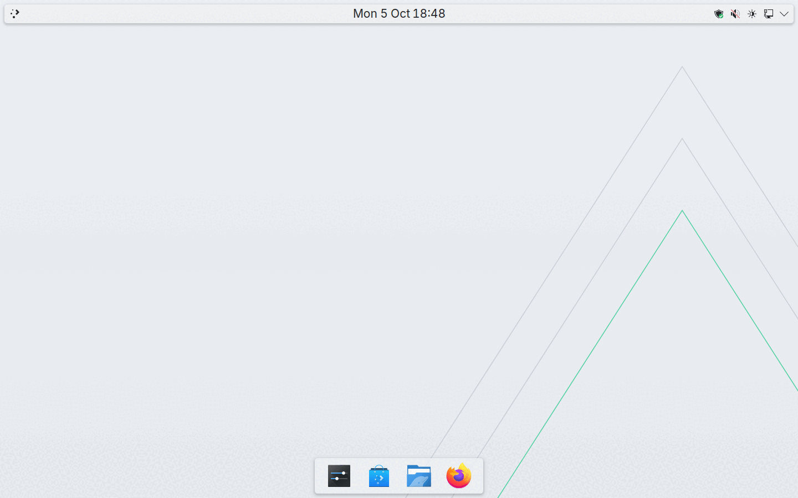
</p>
<p align="center">
  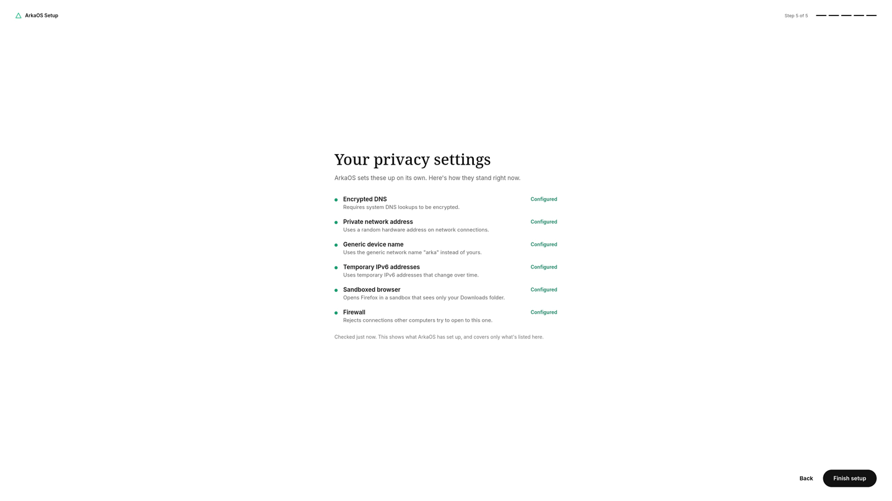
  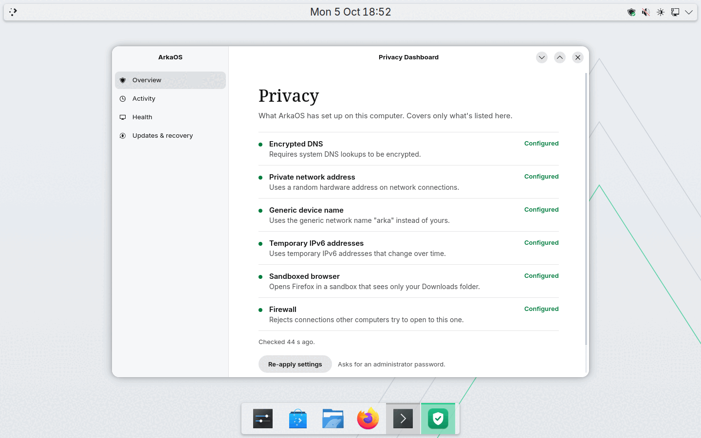
</p>

<details>
<summary><strong>Historical DP1 screenshots (outdated)</strong></summary>

The dashboard score and report's DNS coverage shown below are obsolete
indicators, not evidence of current protection or measured traffic.

<p align="center">
  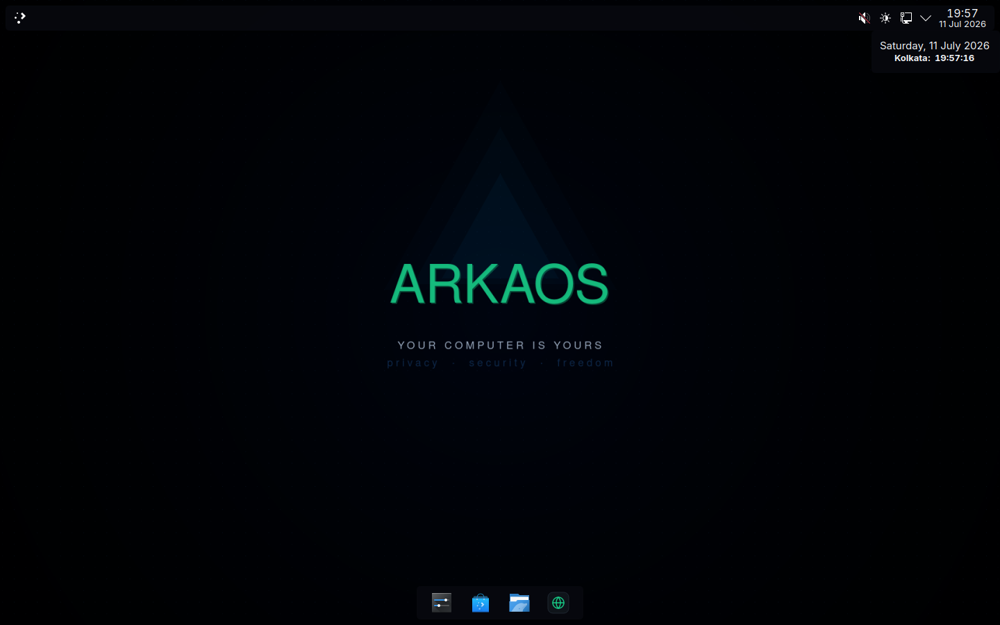
</p>

<p align="center">
  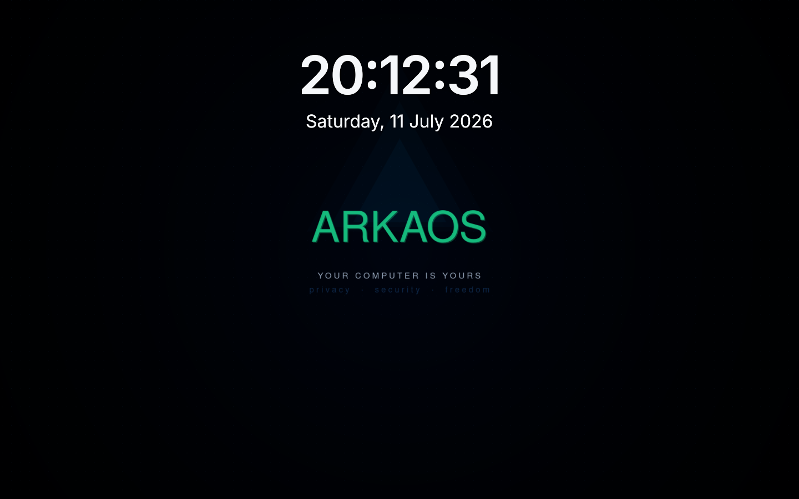
  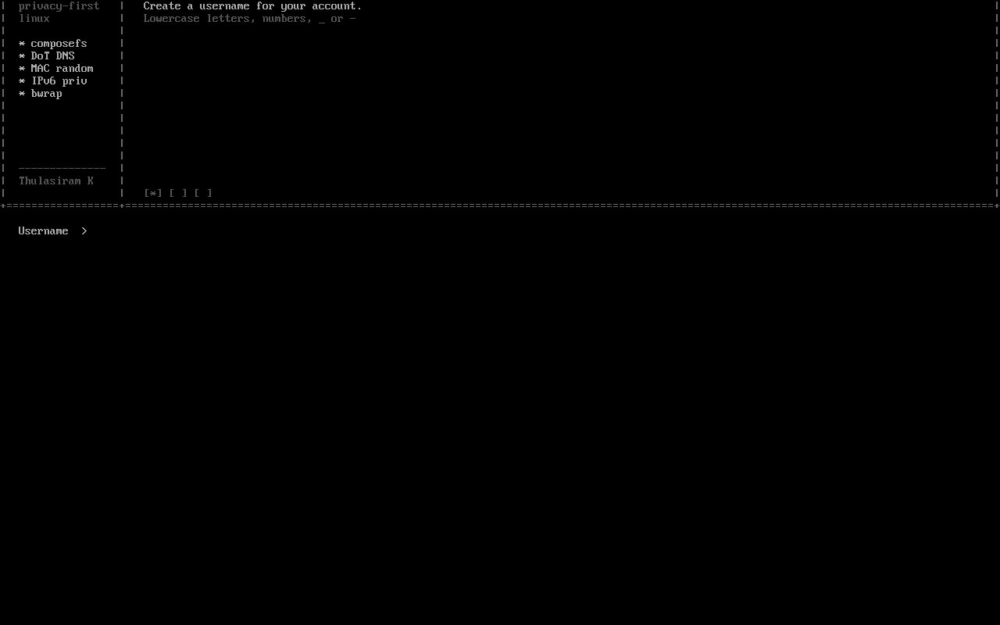
</p>

<p align="center">
  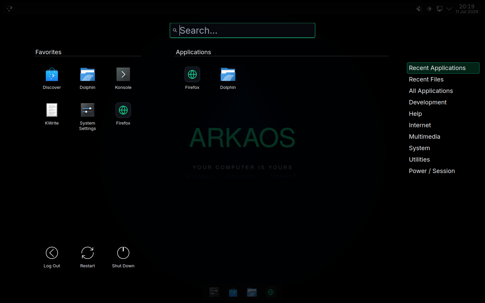
</p>

<p align="center">
  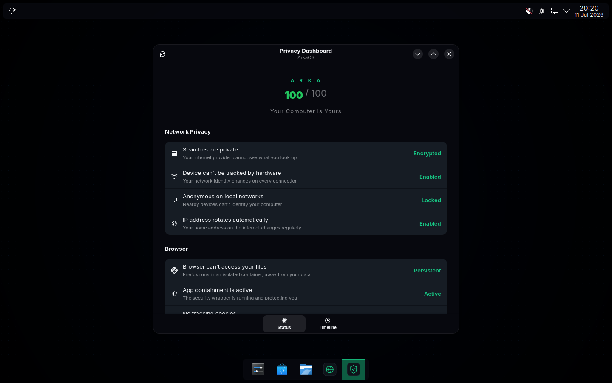
  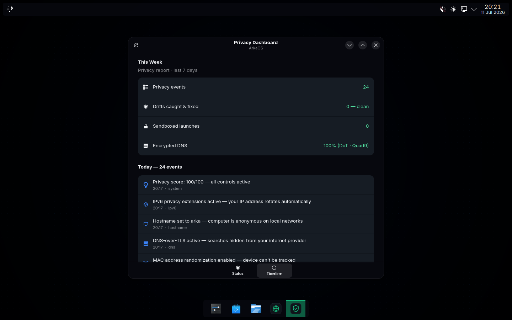
</p>

<p align="center">
  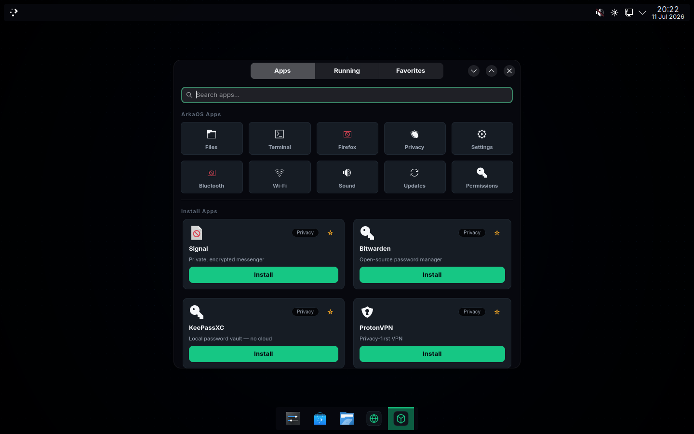
  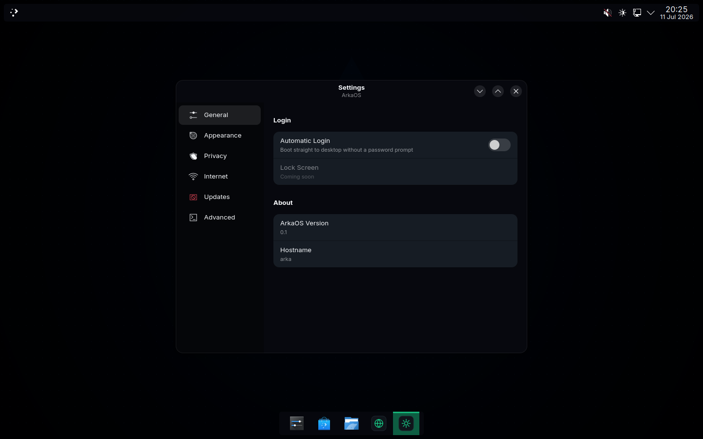
</p>

<p align="center"><em>Live DP1 captures (2026-07-11): desktop, KDE lock screen, first-boot
wizard, full-screen launcher, Privacy Dashboard, Privacy Report, Capsule, and Settings.</em></p>

</details>

## Roadmap

<p align="center">
  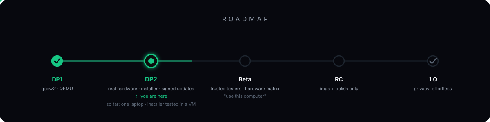
</p>

## Repository

```
Containerfile            the OS — every byte declared here
arkad/                   privacy daemon (Rust, static musl)
arka-shell/              GTK4 first-party apps + shared design tokens & IPC types
arka-design-system/      design spec v1.0 — tokens, motion, components
arka-icons/              icon theme          plymouth-theme-arkaos/   boot splash
sddm-theme-arkaos/       login theme         desktop-files/           launcher entries
arkaos-firefox           sandbox wrapper     arkaos-firstboot         welcome wizard
arka-plasma-firstrun     first-login branding one-shot
arka-apply-look          Light/Dark switch (first login + Settings)
systemd/                 update-status publisher for unprivileged apps
firewalld/               the ArkaOS firewall zone
kernel/                  kernel hardening (boot options + runtime settings)
docs/                    architecture · building · testing · installation · release notes
scripts/                 QA harnesses, make-disk.sh, flash-usb.sh
```

## Documentation

| | |
|---|---|
| [Architecture](docs/ARCHITECTURE.md) | why each piece exists and how they talk |
| [Building](docs/BUILDING.md) | source → image → VM in three commands |
| [Testing](docs/TESTING.md) | verification doctrine, QA harnesses, budgets |
| [Installation](docs/INSTALLATION-ARCHITECTURE.md) | qcow2 today → thin installer later |
| [Design System](arka-design-system/README.md) | tokens, typography, motion, components |
| [Release Notes](docs/RELEASE-NOTES-DP1.md) | what's in DP1, what's known-incomplete |

---

<p align="center">
  <strong>Built on Linux. Designed for people.</strong><br/><br/>
  ▲ <strong>ArkaOS</strong> · <a href="https://github.com/thulasiramk-2310">Thulasiram K</a> · GPL-3.0
</p>
