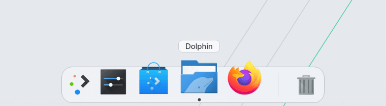

<p align="center">
  
</p>

<h3 align="center">Privacy-first • Immutable • Built on Linux • Designed for people</h3>

<p align="center"><em>A desktop operating system that makes secure computing simple, intuitive, and accessible.</em></p>

<p align="center"><strong><a href="https://thulasiramk-2310.github.io/Arka/">Website</a></strong> · <a href="https://thulasiramk-2310.github.io/Arka/#tour">One-minute tour video</a> · <a href="https://thulasiramk-2310.github.io/Arka/docs/">Docs</a></p>

<p align="center">
  
  
  
  
</p>

<p align="center">
  
</p>

---

## What is ArkaOS?

ArkaOS is a privacy-first, immutable desktop operating system built on Linux,
designed to make secure computing simple, intuitive, and accessible for everyone.

It isn't trying to replace Linux — it builds on Linux's strengths while removing
unnecessary complexity and making powerful privacy and security features
available by default.

The OS ships as a single immutable image: updates are atomic, the previous version is kept,
and the root filesystem is read-only at runtime. A system daemon —
[`arkad`](arkad/) — periodically checks configured privacy settings, retries failures, and logs
selected enforcement events. A successful check describes those settings, not
every application or network connection.

> **Built on Linux. Designed for people.**

## Developer Preview 1

| | | |
|---|---|---|
| ✅ Immutable rootfs (composefs) | ✅ Atomic image updates | ✅ Privacy daemon (arkad) |
| ✅ Privacy Dashboard + weekly report | ✅ Browser sandbox (bubblewrap) | ✅ Permission manager |
| ✅ Branded KDE Plasma shell | ✅ Capsule app store | ✅ Boot animation (Plymouth) |
| ✅ Custom login (SDDM) | ✅ Design System v1.0 | ✅ Icons · cursor · sounds · wallpaper |
| ✅ WiFi · Bluetooth · power profiles | ✅ Search · clipboard · previews | ✅ First-boot welcome wizard |

DP1 ships as a **qcow2 for QEMU/KVM**, developer audience, no installer yet —
by design. Details: [Release Notes](docs/RELEASE-NOTES-DP1.md) · [Changelog](CHANGELOG.md)

## Since DP1 — DP2 groundwork

Source work and recorded test observations toward Developer Preview 2 (see [Field Notes](docs/FIELD-NOTES.md)):

- 🖥️ **First bare-metal boot.** ArkaOS booted on real hardware for the first time —
  an Intel i5-10210U laptop, from a USB stick, internal disk untouched: GRUB → KDE
  Plasma desktop, with Wi-Fi, touchpad, display, brightness and suspend/resume all
  working, and `arka-pulse` reading a real thermal sensor. One machine so far —
  early, but the roadmap's "real hardware" line has its first proof.
- 🩺 **arka-pulse reliability engine.** A read-only *System Health* surface
  (`org.arka.pulse`, mirroring `arkad`): deterministic monitoring, honest about
  what it can't yet measure. See the [design](docs/RELIABILITY-ARKA-PULSE.md).
- 🔒 **Privacy wording under review.** Firefox tracking and fingerprinting-script
  blocking settings reduce some tracking; they do not prevent fingerprinting.
  “Configured” means the checked setting is in place, not “you are protected.”
  Missing or stale checks must remain unknown. See the [threat model](docs/THREAT-MODEL.md).
- 🐞 **Source fixes from real use:** browser audio socket access and Capsule's
  user-level Flathub setup. Playback and installation still need a rebuilt-image
  test on the Nokia; source tests are not hardware confirmation.

- 🎨 **Fedora 44 candidate: new setup and a Light/Dark look.** A rewritten first-boot
  setup (choose Light or Dark, create your account, see where each privacy setting
  stands right now, then sign in). The login screen, desktop, icons and every ArkaOS
  app follow that choice, and Settings › Appearance switches it later. The first
  desktop starts in the ArkaOS look, and the boot logo stays centred when the
  display changes resolution. Tested in a VM in both looks; not yet on hardware.
- 📊 **Privacy Dashboard without a score.** It lists each setting as *Configured*
  or not, says how long ago it was checked, and has a page for updates and
  going back to the previous version.
- ⬆️ **Updates never restart the computer on their own.** They download in the
  background; the Updates app shows the installed version, any downloaded update,
  whether a restart is needed and whether a previous version is available. You
  choose when to restart.
- 🧱 **Firewall on by default.** An ArkaOS firewall zone rejects connections
  other computers try to open to this one. arkad checks the zone's actual rules
  and policies, not just its name, and setup, the dashboard and the tray show it.
- 🌐 **Encrypted DNS with an honest exception.** On a network that blocks encrypted
  DNS (some hotels and sign-in pages), the dashboard notices that names aren't
  resolving and offers to allow unencrypted DNS **on that network only**. It then
  shows *Off on this network*, and other networks stay strict.
- 🛡️ **Kernel hardening.** Stricter kernel boot options (memory wiping,
  lockdown in integrity mode, and others) and runtime settings. User namespaces stay
  on, because Firefox's sandbox and Flatpak need them.
- 🩹 **Automatic rollback after a bad update (greenboot, with two fixes).**
  After you restart into a new version, start-up checks run. If the version fails
  them, or fails before the desktop even starts, the computer restarts and, after
  three failed boots, goes back to the previous version on its own. ArkaOS fixes
  stock greenboot 0.16.4, which never recorded which version to go back to, and
  arms GRUB's boot counter when an update is staged, so a kernel or early-boot
  failure also falls back instead of waiting at a recovery screen. Tested in a VM
  on 2026-10-11: a broken update went back after three failed boots, an update
  that could not start went back within about 30 seconds, a healthy update stayed
  across restarts, `sudo bootc rollback` still works by hand, and the test files
  in `/home` and `/var` were unchanged. On 2026-10-12 the same first and third cases
  also ran on one real laptop (Intel Core i5-10210U, started from a USB stick): the
  broken update went back after three failed boots and the healthy update stayed
  across two restarts. An update that fails before the system starts has not been
  tried on hardware. If applying an update fails at shutdown
  (for example a full `/boot`), ArkaOS keeps the version you were on; stock
  greenboot would roll that healthy system back to an older version
  ([greenboot-rs#219](https://github.com/fedora-iot/greenboot-rs/issues/219)).
  Not yet tested on real hardware.
- 🎯 **App icons:** one family, a distinct colour per app; Firefox and the file
  manager keep their own icons.
- 🐞 **Fixes from the Nokia test:** the disk image no longer enables a serial
  console (the cause of a crash loop there), and `scripts/flash-usb.sh` writes and
  verifies USB sticks and repairs the GPT. In a VM, a Capsule app install from
  Flathub completed. Neither is confirmed on the Nokia yet.

- 💿 **Installer ISO with disk encryption (first version).** `scripts/make-iso.sh`
  builds an installer from the image using Fedora's installer (Anaconda), set up
  in `installer/config.toml`: you pick the disk, nothing is written before
  "Begin Installation", and the disk is encrypted (LUKS2) by default. ArkaOS setup
  creates your account on first boot. Tested in a VM on 2026-10-12: install,
  unlocking at boot, setup with all six settings configured, the desktop, and
  automatic rollback after a broken update. Known limits: the installer still
  shows Fedora's branding, it asks for the passphrase twice, the unlock prompt
  shows the disk's internal name, every restart of an encrypted computer
  (including rollback retries) needs the passphrase, and the ISO (6.7 GB) is
  not published yet. Not tested on real hardware. The installer gives `/boot`
  its own partition. On 2026-10-17 a broken update rolled back on such an
  install even with the ArkaOS greenboot fix switched off, because the trigger
  is stopped together with `/boot` there (as reported on
  [greenboot-rs#218](https://github.com/fedora-iot/greenboot-rs/issues/218)).
  USB images have no separate `/boot` and rely on the fix.

- ✍️ **Signed updates from ghcr.io.** GitHub Actions builds the image on every
  change and once a week, splits it into 65 layers, signs it with cosign and
  publishes it as `ghcr.io/thulasiramk-2310/arka`. ArkaOS accepts an image from
  there only if it is signed with the ArkaOS key (`cosign.pub`). In a VM on
  2026-10-17 an unsigned image and an image checked against another key were both
  refused before anything was downloaded, and the signed image installed and
  booted. A later update downloaded 5 of the 65 layers (863 MB instead of
  5.3 GB). New installs from the installer take their updates from there. Not yet
  on real hardware.
- 🧭 **ArkaOS Dock.** A macOS-style dock replaces the taskbar: pinned and open
  apps, icons that grow above the dock under the pointer, a small label with the
  app's name, a dot under running apps, a divider before Trash, and a bounce
  while an app starts. Behind it the desktop is blurred, on computers whose
  graphics run KDE's blur effect (not in a VM without 3D). It gets out of the
  way only when a window covers it and comes back at the bottom edge; right-click
  it to keep it always visible or to change apps and sizes. It is
  [Crystal Dock](https://github.com/dangvd/crystal-dock) with an ArkaOS patch
  (see `crystal-dock/`). Tested in a VM (2026-10-18), not yet on real hardware.
  Full-screen apps hide it, and it does not come back at the edge until you
  leave full screen.
- 🔎 **ArkaOS launcher.** The button at the top left, or the Meta key, opens a
  panel instead of KDE's full-screen menu: a search box for apps and settings,
  the app categories, your pinned apps, and Lock, Log Out, Restart and Shut
  Down. Right-click an app to pin or unpin it. The line at the bottom shows the
  same privacy status as the tray and opens the Privacy Dashboard. The app list
  and search are Plasma's own, so newly installed apps show up, and the panel
  follows the Light or Dark look. New accounts get it; an older account keeps
  KDE's menu until you right-click it and pick *Show Alternatives*. Tested in a
  VM (2026-10-20) with the mouse and the keyboard, with the Orca screen reader,
  in Light, Dark, at 150% scaling and on two virtual screens; not yet on real
  hardware.
- 🪟 **Window snapping.** Press Meta+Left or Meta+Right to put a window on half
  of the screen, or drag it to a screen edge and a preview shows where it will
  go. This is KDE's own tiling and works as it ships. Tested in a VM
  (2026-10-25) with the keyboard and by dragging; not yet on a touchpad.
- ⚓ **Move the dock.** Settings › Appearance has Bottom, Left and Right for the
  dock. Crystal Dock has no menu entry for this, so Settings changes its setting
  and restarts it. Tested in a VM (2026-10-25): each choice moved the dock and
  one dock kept running.
- 📱 **Link with your phone.** KDE Connect is off by default. Settings › Internet
  has a switch that starts it now and at every login, and turns it off again.
  While it runs, phones and computers on the same network can find this
  computer. Tested in a VM (2026-10-25): it started and stopped, port 1716
  opened and closed, and it came back after logging in again. Not tested with a
  real phone.
- 🐢 **Reduce motion.** Settings › Appearance has a switch that turns off most
  window, menu and desktop animations. It uses KDE's own animation setting, so
  windows, menus and the shell all follow it, and turning it off returns to
  KDE's normal speed. Tested in a VM (2026-10-25): the setting is written and
  removed, and Settings shows the real value when reopened. I checked in KWin's
  source that it watches the setting, but did not time the animations.
- ⛰️ **ArkaOS popups.** Notifications, the volume and brightness popups, the
  calendar, the tray and the launcher have corners cut at 45 degrees, like the
  peaks in the ArkaOS mark and wallpaper, with a thin border and a soft shadow.
  The launcher's search field, highlights and tiles have the same corners. It is
  part of the ArkaOS Plasma style, so it follows Light and Dark. Tested in a VM
  (2026-10-20).
- 🖥️ **A top bar on every screen.** Each screen gets the bar with the
  launcher, clock and tray, including a screen plugged in later. A bar you
  remove from a screen stays removed. Tested in a VM with two virtual screens
  (2026-10-20); not yet with real monitors.
- 📵 **KDE Connect is off by default.** While it runs, it makes the computer
  visible to phones and computers on the same network. It no longer starts at
  login, from the tray or from Dolphin's right-click menu. Opening the KDE
  Connect app turns it on until you log out, and adding its widget back to the
  tray starts it at every login. Existing accounts get this with the update.
  Tested in a VM (2026-10-20).
- 🔒 **A readable lock screen in Light.** The lock screen keeps the dark
  wallpaper, as the login screen does, so its white clock stays readable. New
  accounts' trays leave out Weather and Vaults; both can be switched back on in
  the tray's settings. Tested in a VM (2026-10-20).
- 🔁 **Convert files from the right-click menu.** In Dolphin, *Convert to* turns
  pictures into PNG, JPEG, WebP or PDF, a PDF into one PNG per page or a smaller
  PDF (pictures reduced to 150 dpi; nothing is kept if it would not be smaller),
  sound into MP3, FLAC, WAV, Ogg, Opus or AAC, and video into MP4 (H.264), MKV
  or WebM, or just its sound as MP3. The copy is saved next to the original and
  never replaces a file. Each converter (ffmpeg, Pillow, poppler, Ghostscript)
  runs in a sandbox with no network access. Long sound and video conversions
  show their progress, and stopping one leaves no half-made file behind. Tested in a VM (2026-10-19 and
  2026-10-20); not yet on real hardware. Dolphin's preview of a very short
  H.264 video (about 2 seconds) can look scrambled; the file itself is fine.
- 🧹 **Remove hidden details.** Photos, PDFs, sound and video files often carry
  details you can't see: where a photo was taken, the camera, the author's name,
  the software that made a document. *Remove hidden details* in Dolphin's
  right-click menu saves a copy without them, made by
  [mat2](https://0xacab.org/jvoisin/mat2) inside the same no-network sandbox.
  It works on PNG, JPEG, WebP, GIF, BMP, TIFF, PDF, MP3, FLAC, Ogg, WAV, MP4 and
  AVI files. It removes what mat2 knows about; it cannot remove what is in the
  picture or sound itself. Pictures are saved again, which can change a JPEG
  slightly. Tested in a VM (2026-10-20): a photo's camera and author, a video's
  GPS position and a PDF's author were gone from the copies.
- 🎡 **Format wheel.** Drag a file, press Meta+Alt+C, and a ring of the formats
  that file can become appears at the pointer; drop the file on one to convert
  it. *Convert with the format wheel* in the right-click menu opens the same
  ring for clicking. The shortcut can be changed in System Settings › Shortcuts.
  Tested in a VM with drags from Dolphin, Gwenview and Firefox (2026-10-19); not
  yet with a real touchpad.
- 🧬 **VARA and Git for writing code.** Under *Advanced options*, setup can set
  up [VARA](https://github.com/thulasiramk-2310/vara) (version control with
  built-in undo and integrity checks) and Git with the name and email for your
  commits. Settings › Developer tools changes them later and can run a VARA Hub,
  a web view of your repositories that only this computer can reach. The Hub is
  off until you switch it on. VARA is built from its v0.4.4 release. Tested in a
  VM (2026-10-20); not yet on real hardware.
- 🖐️ **Natural touchpad scrolling by default**, as on macOS, Windows and GNOME
  (content follows the fingers). It can be turned off in System Settings. Tested
  in a VM with a virtual touchpad; not yet on a real one.
- 🔕 **Fewer false privacy alarms.** The tray only warns about a problem that
  lasts about 30 seconds, so a firewall that is slow to start, or a setting
  arkad fixes at once, no longer shows a popup. When a setting comes back on its
  own, the log says *Setting confirmed again*. Tested in a VM (2026-10-14).

Everything above was tested in a VM between 2026-10-11 and 2026-10-20 unless it
says otherwise. Still a developer preview: the installer is new and VM-tested only, one
hardware data point, and known polish tracked in the field notes.

---

## Architecture

<p align="center">
  
</p>

Why bootc, why Plasma, why D-Bus, why not our own compositor — the reasoning
lives in [docs/ARCHITECTURE.md](docs/ARCHITECTURE.md).

## The privacy model

<p align="center">
  
</p>

**The browser has a restricted filesystem view.** The wrapper hides the real
home except `~/Downloads`, which remains readable and writable. It exposes
allowlisted system files, Wayland and audio sockets; audio access can include
microphone recording. Session D-Bus is hidden. Earlier isolation checks are
recorded in [PHASE4-SANDBOX.md](PHASE4-SANDBOX.md); each release still needs testing.

**Periodic configuration checks:** arkad attempts MAC randomization, strict
DNS-over-TLS policy, a generic hostname, IPv6 temporary-address settings and the
ArkaOS firewall zone. A per-network DNS exception is shown as such, never as
encrypted.
Checks can fail; configured DNS policy does not prove that every app uses it.
The tray requires a completed check less than three 30-second polls old.
OS rollback selects another system deployment; it does not restore older
personal files or guarantee that the selected image will boot.

## From one image, everything

<p align="center">
  
</p>

Installation is delivery, not configuration — however the bits land on disk,
the system that boots is byte-identical and greets you with the same welcome
wizard. Strategy: [docs/INSTALLATION-ARCHITECTURE.md](docs/INSTALLATION-ARCHITECTURE.md)

## How it's built

<p align="center">
  
</p>

**Compile success ≠ runtime correctness.** Every change boots in a VM before it
merges; security claims require proofs against the deployed artifact; releases
gate on a 100-boot reliability loop. Doctrine and harnesses:
[docs/TESTING.md](docs/TESTING.md) · Build it yourself:
[docs/BUILDING.md](docs/BUILDING.md)

## Screenshots

Fedora 44 candidate, light look, from a VM test of a built image:

<p align="center">
  
</p>
<p align="center">
  
</p>
<p align="center">
  
  
</p>

<details>
<summary><strong>Historical DP1 screenshots (outdated)</strong></summary>

The dashboard score and report's DNS coverage shown below are obsolete
indicators, not evidence of current protection or measured traffic.

<p align="center">
  
</p>

<p align="center">
  
  
</p>

<p align="center">
  
</p>

<p align="center">
  
  
</p>

<p align="center">
  
  
</p>

<p align="center"><em>Live DP1 captures (2026-07-11): desktop, KDE lock screen, first-boot
wizard, full-screen launcher, Privacy Dashboard, Privacy Report, Capsule, and Settings.</em></p>

</details>

## Roadmap

<p align="center">
  
</p>

## Repository

```
Containerfile            the OS — every byte declared here
arkad/                   privacy daemon (Rust, static musl)
arka-shell/              GTK4 first-party apps + shared design tokens & IPC types
arka-design-system/      design spec v1.0 — tokens, motion, components
arka-icons/              icon theme          plymouth-theme-arkaos/   boot splash
sddm-theme-arkaos/       login theme         desktop-files/           launcher entries
arkaos-firefox           sandbox wrapper     arkaos-firstboot         welcome wizard
arka-plasma-firstrun     first-login branding one-shot
arka-apply-look          Light/Dark switch (first login + Settings)
systemd/                 update-status publisher for unprivileged apps
firewalld/               the ArkaOS firewall zone
kernel/                  kernel hardening (boot options + runtime settings)
docs/                    architecture · building · testing · installation · release notes
scripts/                 QA harnesses, make-disk.sh, flash-usb.sh
```

## Documentation

| | |
|---|---|
| [Architecture](docs/ARCHITECTURE.md) | why each piece exists and how they talk |
| [Building](docs/BUILDING.md) | source → image → VM in three commands |
| [Testing](docs/TESTING.md) | verification doctrine, QA harnesses, budgets |
| [Installation](docs/INSTALLATION-ARCHITECTURE.md) | VM image, USB image and installer ISO |
| [Design System](arka-design-system/README.md) | tokens, typography, motion, components |
| [Release Notes](docs/RELEASE-NOTES-DP1.md) | what's in DP1, what's known-incomplete |

---

<p align="center">
  <strong>Built on Linux. Designed for people.</strong><br/><br/>
  ▲ <strong>ArkaOS</strong> · <a href="https://github.com/thulasiramk-2310">Thulasiram K</a> · GPL-3.0
</p>
